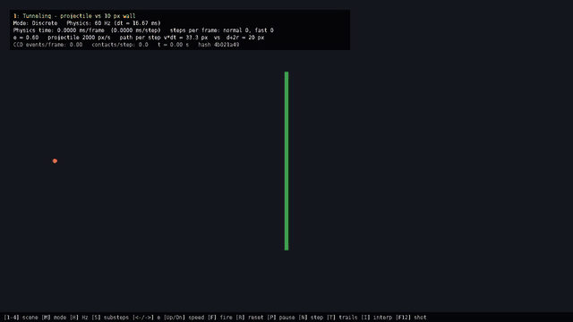

# 2D rigid body физика: CCD и multi-rate симуляция

Практическое задание №3 по дисциплине «Моделирование физических процессов» (блок «Механика»).

Упрощённый 2D-движок твёрдых тел (круги и прямоугольники AABB без вращения) с тремя режимами:

| Режим | Что делает |
|---|---|
| **Discrete** | Классический дискретный шаг: интегрирование, затем проверка пересечений в конце шага. Быстрый снаряд туннелирует. |
| **CCD** | Continuous Collision Detection: внутри шага ищется момент первого касания `t_c`, тела переносятся к нему, считается отклик, шаг доинтегрируется. |
| **Multi-rate** | Обычные тела обновляются с частотой 60 Гц, быстрые (снаряды) — 240 Гц (4 подшага на кадр). |



## Сборка

Внешняя зависимость одна: **SDL2** (окно и отрисовка). Если SDL2 не установлен,
CMake сам скачает исходники SDL2 2.30.9 (FetchContent) и соберёт их статически,
поэтому ставить SDL2 вручную не нужно. Нужен только интернет при первой сборке.

### Windows, Visual Studio 2022

1. Установить Visual Studio 2022 с рабочей нагрузкой **«Разработка классических приложений на C++»**
   (в неё входят CMake и Ninja).
2. *Файл → Открыть → Папка…* и выбрать папку проекта.
3. Дождаться окончания конфигурации CMake (первый раз 1–3 минуты: скачивается и собирается SDL2).
4. В выпадающем списке конфигураций выбрать **x64 Release** (для замеров времени именно Release).
5. В списке целей запуска выбрать **phys_demo.exe** и нажать **F5** (или Ctrl+F5).

### Командная строка (Windows / Linux / macOS)

```bash
cmake -S . -B build -DCMAKE_BUILD_TYPE=Release
cmake --build build --config Release
./build/phys_demo          # Windows: build\Release\phys_demo.exe или build\phys_demo.exe
./build/phys_bench         # консольные замеры
```

Если SDL2 уже установлен (vcpkg, apt, brew), он будет найден через `find_package(SDL2)`.
Собрать только ядро и замеры без SDL2: `-DPHYS2D_BUILD_APP=OFF`.

## Управление

| Клавиша | Действие |
|---|---|
| `1` – `4` | Выбор сцены (режим переключается на рекомендованный для сцены) |
| `M` | Переключить режим: Discrete → CCD → Multi-rate (в рантайме, без сброса) |
| `H` | Частота физики: 60 → 120 → 240 Гц (сцена перезапускается) |
| `S` | Число подшагов быстрых тел в Multi-rate: 1 → 2 → 4 → 8 |
| `←` / `→` | Коэффициент восстановления e −0.1 / +0.1 |
| `↑` / `↓` | Скорость снаряда ±250 px/с (сцена перезапускается) |
| `F` | Перезапустить снаряды / выстрелить в башню (сцена 4) |
| `R` | Перезапустить сцену |
| `P` | Пауза |
| `N` | Один шаг физики (на паузе) |
| `T` | Следы снарядов (положения после каждого шага физики) |
| `I` | Интерполяция отрисовки между шагами |
| `F12` | Скриншот (`screenshot_NNN.bmp` в рабочей папке) |
| `Esc` | Выход |

## Сцены

1. **Tunneling.** Снаряд r = 5 px летит со скоростью 2000 px/с в стенку толщиной 10 px, физика 60 Гц.
   Стартовая точка выбрана в «худшей фазе»: середина между двумя соседними положениями снаряда
   совпадает с центром стенки. Поэтому снаряд проскакивает ровно тогда, когда `v·Δt > d + 2r`.
   Discrete — проскок, CCD — отскок (жёлтый крестик — найденная точка контакта).
2. **Experiment 60/240.** Один и тот же снаряд: сверху — в группе обычных тел (60 Гц), снизу —
   в группе быстрых (240 Гц). Верхний туннелирует, нижний отскакивает.
3. **Multi-rate arena.** 6 неподвижных тел (4 стены по 20 px и 2 препятствия 64×64 — вдвое больше
   самого крупного обычного тела), 50 обычных (40 кругов и 10 квадратов разного размера), 8 быстрых снарядов.
   Счётчик показывает, сколько снарядов проскочило стены арены.
4. **Stack.** Башня из 8 блоков, пирамида из 15 блоков и 40 шаров в «стакане» — проверка устойчивости.

## Параметры

Все основные параметры собраны в [`src/core/Config.h`](src/core/Config.h): частота физики,
число подшагов, скорость и радиус снаряда, толщина стенки, коэффициент восстановления,
гравитация, параметры решателя. После изменения пересоберите проект.

## Замеры

`phys_bench` печатает:
- минимальный эксперимент (60/120/240 Гц и CCD): проскок или отскок, время шага и кадра;
- арену во всех режимах: ms/frame, число шагов обычных/быстрых тел на кадр, число вылетов, детерминированность;
- стопку: RMS-скорость тел в покое («дрожание»), максимальное проникновение, просадку башни.

Пример вывода — в [`docs/bench_results.txt`](docs/bench_results.txt).

### Захват кадров без окна

```bash
phys_demo --scene 1 --mode ccd --frames 30 --shots 15,16,22 --out shots/ccd
phys_demo --scene 3 --substeps 1 --frames 300 --dump-every 2 --out frames/arena
```
Параметры: `--scene N`, `--mode discrete|ccd|multirate`, `--hz`, `--substeps`, `--e`, `--speed`,
`--frames K`, `--shots a,b,c`, `--dump-every K`, `--out prefix`, `--fire-at K`, `--no-trails`.

## Структура проекта

```
src/core/Vec2.h        2D-вектор (double)
src/core/Body.h        тело: круг или AABB, группа Static / Normal / Fast
src/core/Config.h      все настраиваемые параметры
src/core/Collision.*   дискретные проверки и CCD (time of impact)
src/core/World.*       шаг симуляции: Discrete, CCD, Multi-rate; решатель контактов
src/core/Scenes.*      демонстрационные сцены
src/app/main.cpp       окно SDL2, фиксированный шаг (аккумулятор), HUD, управление
src/app/Render.*       отрисовка (SDL_RenderGeometry), растровый шрифт
src/bench/bench.cpp    консольные замеры
```
